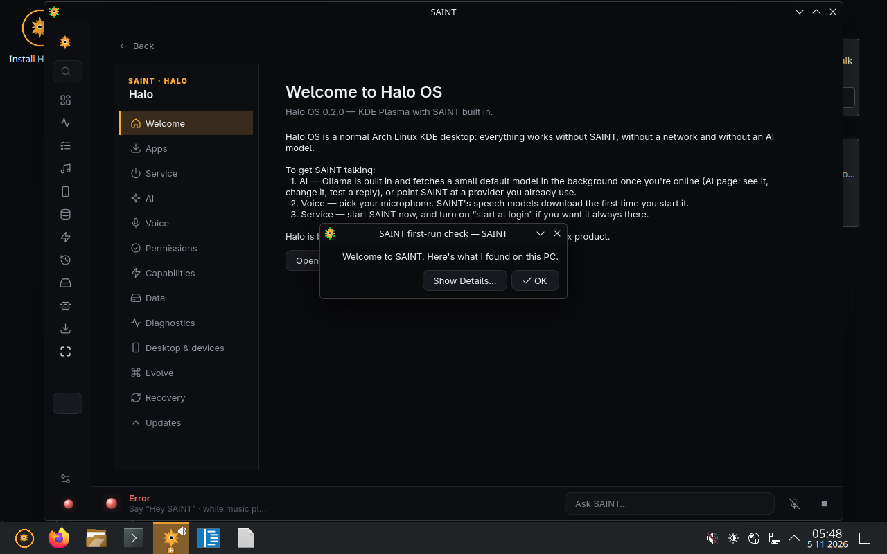

<p align="center"></p>

<h1 align="center">HalOS</h1>

<p align="center"><b>A Linux desktop with a local, voice-first AI assistant built in.</b><br>
Arch Linux + KDE Plasma 6 on Wayland, with SAINT at its centre — say “Hey SAINT”, it does the real thing and
answers out loud. Everything runs on your PC.</p>

<p align="center">HalOS 0.2.0 (preview) · SAINT 0.4 ·
<a href="HALOS_STATUS.md">status</a> · <a href="HALOS_ROADMAP.md">roadmap</a> ·
<a href="HALOS_TEST_RESULTS.md">test results</a></p>



HalOS is a normal Arch Linux KDE desktop — everything works without SAINT, without a network and without an
AI model — with SAINT built into the system: the Halo overlay, a Store that installs anything, a health page
that tells the truth about every subsystem, and an agent that can extend the OS itself, always with your
approval and a snapshot to roll back to.

> **Preview.** Build #9 boots to the desktop with SAINT running in UEFI and BIOS VMs and passes every image
> check. Installing to disk, Secure Boot and real GPUs have not been verified on hardware yet — see
> [HALOS_STATUS.md](HALOS_STATUS.md). Keep a backup before installing next to Windows.

## What's in it

| | |
|---|---|
| **SAINT, built in** | Wake word, Whisper speech recognition and the Kokoro voice ship in the image; Ollama with an 8B model (`llama3.1:8b`, ~5 GB) downloaded in the background after install, progress shown in SAINT. Small model on PCs with < 12 GB RAM and no GPU. |
| **The Halo** | <kbd>Alt</kbd>+<kbd>`</kbd> overlay, screen-edge Halo, command palette (<kbd>Ctrl</kbd>+<kbd>K</kbd>), floating Halo and music widgets, SAINT Task Manager (<kbd>Ctrl</kbd>+<kbd>Shift</kbd>+<kbd>Esc</kbd>). Halo Dark by default, Halo Light in Settings. |
| **One Store for everything** | One search over SAINT's picks, Arch repos, Flathub, the AUR and Windows apps (Wine). Real AppStream metadata and screenshots, filters for how an app runs and whether it's installed, and an install assistant for links, GitHub releases and package files (`.pkg.tar.zst`, `.flatpakref`, `.AppImage`, `.deb`, `.exe`/`.msi`): plan → approve → install → check it launches, with history, repair and uninstall. Native versions are preferred; apps that can't work (kernel anti-cheat) say so. |
| **Health that tells the truth** | Every subsystem — Ollama inference, Kokoro, Whisper, Flathub, pacman, network, GPU, storage — is Working, Degraded, Missing, Failed or Not tested, from a real check. A dependency manager repairs what's missing, after you confirm. |
| **Evolve** | SAINT can change its own source and the OS with Claude Code (your account): plan → you approve → Btrfs snapshot → apply in a separate git worktree → tests → keep or roll back. |
| **Your phone and other PCs** | SAINT Link (encrypted pairing), the iPhone app, KDE Connect, and Halo Remote: remote desktop from a browser, the desktop app or iPhone, with monitor selection and automatic reconnection through a self-hostable relay. |
| **Hardware** | NVIDIA open driver (`nvidia-open`) loaded only when an NVIDIA GPU (Turing or newer, incl. RTX 50) is present; Secure Boot through Microsoft-signed shim + a one-time key enrolment; dual boot with Windows via GRUB + os-prober, reusing a small Windows EFI partition. |
| **Apps** | Firefox, Dolphin, Konsole, SAINT, VS Code and Spotify (Flathub, installed on first network) pinned; Steam/Heroic, Discord and the rest one Store search away. |

## Get HalOS

### 1. Build the ISO

| Host | How |
|---|---|
| Any x86_64 Linux with podman/docker | `packaging/arch/build_in_container.sh --workdir /var/tmp/halo-build` |
| Arch Linux (root) | `packaging/arch/build_iso.sh --workdir /var/tmp/halo-build` |
| Windows + VirtualBox (no WSL needed) | Boot an Arch ISO in a VM with an empty ≥ 120 GB virtual disk, then run [`packaging/windows-host/vbox-build/prepare.sh`](packaging/windows-host/vbox-build/prepare.sh) and [`build.sh`](packaging/windows-host/vbox-build/build.sh) as root over SSH |
| Windows + WSL2 | `packaging\windows-host\build_iso.ps1` |

Output in `dist/halo/`: `Halo-x86_64.iso` (~4.3 GB), `SHA256SUMS`, `VALIDATION.txt`, build info. A first build
takes about 45 minutes; caches make later ones faster. Details: [docs/BUILDING_HALO.md](docs/BUILDING_HALO.md).

### 2. Test it in a VM

```powershell
powershell -ExecutionPolicy Bypass -File packaging\windows-host\boot_test.ps1 -Iso dist\halo\Halo-x86_64.iso
```

Boots the ISO in throwaway UEFI and BIOS VirtualBox VMs and passes when the image reports boot, desktop and
SAINT on its serial port. More: [docs/VM_TESTING.md](docs/VM_TESTING.md).

### 3. Boot it on your PC

- **From a USB stick (8 GB+):** Rufus in DD mode or Ventoy — [packaging/windows-host/write_usb.md](packaging/windows-host/write_usb.md).
- **Without a USB stick (Windows PCs):** `packaging\windows-host\prepare_disk_boot.ps1` (Administrator) shrinks
  `C:`, puts the live system on a 6 GB `HALOLIVE` partition, leaves the install space unallocated and adds a
  "HalOS (live)" boot entry. It refuses to run while BitLocker protection is on. `-WhatIf` shows the plan.

### 4. Install next to Windows

Suspend BitLocker, turn off Fast Startup, leave the space for Halo unallocated, then in the live session run
**Install HalOS** (Calamares, manual partitioning: btrfs `/` in the free space, the existing EFI partition at
`/boot/efi`, not formatted). The first boot after installing asks once to enrol Halo's Secure Boot key.
Step by step: [docs/DUAL_BOOT_INSTALLATION.md](docs/DUAL_BOOT_INSTALLATION.md) ·
for the developer's own PC: [docs/INSTALL_ON_THIS_PC.md](docs/INSTALL_ON_THIS_PC.md).

## SAINT

SAINT is the assistant at the centre of HalOS, and it still runs on its own on **Windows 10/11**.

- **Voice first.** “Hey SAINT” / “SAINT”, follow-ups without the wake word, interruptions. While music plays,
  “skip”, “pause”, “louder” work on their own.
- **Does whole tasks and checks its work.** A request becomes a plan run step by step; each step is checked
  (the window is there, the server answers, the song is playing), and finished tasks are learned. Simple
  requests stay instant — no planner, no model call.
- **Safe, Confirm or Autonomous.** Every step has a risk level; anything that sends, deletes or closes waits for
  your yes.
- **Your PC by voice** — apps, windows across monitors, keyboard and mouse, browser, files, Spotify, reminders,
  schedules, memory — and a development helper (“run the tests”, “why won't it start?”).

| You say | What happens |
|---|---|
| “Hey SAINT, play my gym playlist” · “skip 3 songs” · “louder” | Spotify and playback |
| “open Discord” · “move this window to my second monitor” | Apps and windows |
| “install Notepad++” · “is Heroic installed?” | The Store (HalOS) |
| “what's on my second screen?” · “what is this error?” | Screen understanding |
| “remind me at 5 PM to stretch” · “every weekday at 9 play my focus playlist” | Reminders and schedules |
| “set up my coding workspace and tell me when it's ready” | An agent task: plan, act, check each step |
| “stop” · “cancel” | Stops speaking and whatever is running |

The [guide](docs/GUIDE.md) has everything SAINT understands.

### SAINT on Windows

Download `SAINT-Setup.exe` from the [latest release](https://github.com/uberdiz/SAINT/releases/tag/unified-latest),
or from source (Python 3.12, NVIDIA GPU recommended):

```bat
git clone https://github.com/uberdiz/Halo.git
cd Halo
setup.bat
run.bat
```

Install [Ollama](https://ollama.com) and `ollama pull llama3.1:8b` for conversation. Use
`pip install -r requirements.txt` **without** `--upgrade` (it would swap the CUDA torch for a CPU one and
break Kokoro). `run.bat --profile clean` tests as a fresh install without touching your data. The Windows
installer is built with `.venv\Scripts\python packaging\windows\build.py`.

## How v2 is being built

The v2 work (AI control of the OS, easier install, bring-everything migration) is written up as it lands, with screenshots: [wave 1](docs/process/wave-1.md), [wave 1, continued](docs/process/wave-1b.md), [waves 2 and 3](docs/process/wave-2-3.md). One line per finished item is in [docs/PROGRESS.md](docs/PROGRESS.md), and the plan is [docs/FABLE_MASTER_PROMPT.md](docs/FABLE_MASTER_PROMPT.md).

## Repository

| Path | What |
|---|---|
| `app.py`, `core/`, `modules/`, `ui/` | SAINT (Python 3.12, PySide6): assistant, Store, health, Evolve, Control Center |
| `packaging/arch/` | HalOS image: archiso profile, `[halo]` packages (`saint`, `halo-branding`, `halo-system`, `halo-calamares-config`), build and validation scripts |
| `packaging/linux/rootfs/` | Files installed into the OS: KWin scripts/effects, Plasma defaults, services |
| `packaging/windows-host/` | Building, boot-testing and installing HalOS from a Windows PC |
| `modules/remote_desktop/`, `server/relay/`, `web/remote/` | Halo Remote: host, relay, browser client |
| `mobile/ios/` | The iPhone app (built on macOS by GitHub Actions) |
| `tests/` | ~1,770 pytest tests; `node --test "web/remote/test/*.test.mjs"` for the browser client |

## Development

```bat
.venv\Scripts\python -m pytest -q
```

HalOS work follows [HALOS_ROADMAP.md](HALOS_ROADMAP.md); what has actually been verified is in
[HALOS_TEST_RESULTS.md](HALOS_TEST_RESULTS.md). Architecture: [docs/ARCHITECTURE.md](docs/ARCHITECTURE.md) ·
remote desktop: [docs/REMOTE_DESKTOP.md](docs/REMOTE_DESKTOP.md) · manual checks:
[docs/MANUAL_TESTING.md](docs/MANUAL_TESTING.md) · changes: [docs/CHANGELOG.md](docs/CHANGELOG.md).

## Privacy

Wake word, speech recognition, voice and the language model run on your PC. Memory, history and settings stay
on it (`~/.local/share/SAINT` on HalOS, `%LOCALAPPDATA%\SAINT` on Windows). Network use is only what you ask
for: package and model downloads, Spotify, web search if you enable a provider, and SAINT Link / Halo Remote
between your own devices. Evolve sends code to Claude only when you start a change.


> **Roadmap for the next major release:** see [docs/FABLE_MASTER_PROMPT.md](docs/FABLE_MASTER_PROMPT.md) — the one-click-install, keep-everything, faster/smaller/free Windows replacement plan.
