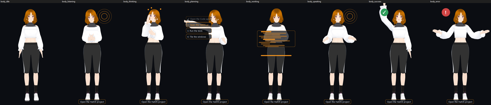

<p align="center"></p>

<h1 align="center">HalOS</h1>

<p align="center"><b>The AI operating system: a Linux desktop that an AI can run for you, with your approval.</b><br>
Arch Linux + KDE Plasma 6 on Wayland. Its built-in assistant, SAINT, listens for “Hey SAINT” and then does
the task itself: it changes settings, manages files and windows, installs apps, and hands bigger jobs to
Claude Code on your own Claude subscription. Voice, speech recognition and local models run on your PC.</p>

<p align="center">HalOS 2.2 beta ·
<a href="https://github.com/uberdiz/Halo/releases">download</a> ·
<a href="docs/INSTALL_GUIDE.md">install guide</a> ·
<a href="docs/KNOWN_ISSUES.md">known issues</a> ·
<a href="docs/RELEASE_NOTES_2.2.md">what's new + what to test</a> ·
<a href="HALOS_STATUS.md">status</a> ·
<a href="docs/PROGRESS.md">progress</a></p>

> ### ⬇ Download HalOS 2.2.0-beta.1
> **[HalOS-Setup.exe](https://github.com/uberdiz/Halo/releases/download/v2.2.0-beta.1/HalOS-Setup.exe)** (61 KB):
> run it on Windows 10/11 and it downloads, checks and installs HalOS next to Windows. No USB stick needed.
> Prefer a USB stick? Get the ISO parts from the
> [release page](https://github.com/uberdiz/Halo/releases/tag/v2.2.0-beta.1) ([how](#from-a-usb-stick)).
> The iPhone app (`SaintMobile-unsigned.ipa`) is on the same page.


HalOS works as a normal desktop without SAINT, without a network, and without an AI model. With SAINT, the
AI runs the OS through a typed set of actions. You decide how far it can go: *ask every time*, *ask when
risky*, or *trusted*. Deleting something always asks first. Every action is logged and can be undone.

> **Beta.** v2.2.0-beta builds pass every image check and boot to the desktop in UEFI and BIOS VMs. They haven't
> yet been installed on real hardware. Keep a backup before installing next to Windows. See
> [KNOWN_ISSUES.md](docs/KNOWN_ISSUES.md) and [HALOS_STATUS.md](HALOS_STATUS.md).

## What's new in 2.2

Full list with test steps: [docs/RELEASE_NOTES_2.2.md](docs/RELEASE_NOTES_2.2.md). Step-by-step install: [docs/INSTALL_GUIDE.md](docs/INSTALL_GUIDE.md).

| | |
|---|---|
| **Fluid look** | Floating blurred panel, blurred menus, borderless windows with soft shadows, Inter, quicker animations, the accent colour taken from your wallpaper, slideshows, and the new *Fold away* close animation. |
| **A companion, not a mascot** | SAINT's avatar sits on title bars, peeks from edges, climbs, dances to music, pops in next to whatever SAINT is working on, hides for games, wears outfits, and learns new moves you string together. |
| **New apps** | Files with tabs, every drive and folder sizes; a grouped Task Manager; one live Downloads page; **Passwords** with Apple/Chrome/Firefox/Bitwarden import, 2FA codes and fill-in (SAINT never reads passwords). |
| **Wallpapers** | Living wallpapers apply instantly, a bar visualizer, and Steam **Wallpaper Engine** wallpapers. |
| **Updates without reinstalling** | Settings → Updates installs new SAINT versions from GitHub and can go back in one click. Developers can hot-patch a running HalOS over SSH. |
| **Fixes** | Sound on laptops that showed only "Dummy Output", the SAINT icon bringing the window up, a boot menu entry to start from USB or Windows on any disk, AIDE's own logo. |

## What's new in 2.1



| | |
|---|---|
| **SAINT has a body** | SAINT is a 3D character (VRM 1.0) on your desktop. She blinks, her mouth moves while she talks, her face follows how things are going, and her whole body acts out what she's doing: leaning in to listen, hand to chin while thinking, pointing at the plan, typing at a floating screen while she works, waving when it's done, shrugging when it isn't. Floating or corner, full body or portrait, realistic or a hologram in your accent colour, more or less motion. Import your own `.vrm`, `.glb` or picture (checked, never executed). |
| **Visual Shop** | Wallpapers, living wallpapers, colour schemes, accent palettes, icons and avatars, each with its creator, licence and SHA-256. Import your own packs; scripts and programs are refused. |
| **System Overview** | Per-core CPU, the full NVIDIA picture (VRAM, load, power, clocks, temperature, throttling, which processes use the GPU), disk and network activity, failed services, and history from live to 7 days. |
| **SAINT knows your PC** | “What's using my GPU?”, “Is Ollama on my GPU?”, “Can my computer run a 14B model?” are answered from real sensors, without a language model. |
| **Home** | Reminders (snooze, dismiss, quick add), SAINT's tasks, a PC summary and your own quick actions. |
| **Models that work** | Model downloads refuse duplicates and models too big for the PC, then run a short real test and say whether it runs on CUDA or the CPU. |
| **Public beta docs** | [Install](docs/INSTALL.md), [troubleshooting](docs/TROUBLESHOOTING.md), [recovery](docs/RECOVERY.md), [privacy](docs/PRIVACY.md), [known issues](docs/KNOWN_ISSUES.md), [contributing](CONTRIBUTING.md), issue templates, [release notes](docs/RELEASE_NOTES_2.1.md). |

How 2.1 was built, step by step: [docs/process/halos-2.1.md](docs/process/halos-2.1.md).

## What's new in 2.0

| | |
|---|---|
| **Install like a browser** | **HalOS-Setup.exe** (56 KB) runs from Windows, with no USB stick needed. It checks UEFI, Secure Boot, BitLocker and free space, then downloads the newest release (resumable, checksum-verified) and makes room for HalOS. It then restarts into a 3-page installer. **Update HalOS** replaces an older HalOS or SAINT OS and leaves Windows alone. |
| **AI that manages the OS** | 45 actions in 9 areas: settings, network, files, packages, services, power, windows, shell and background. Trust is set per area. Multi-step jobs show a live plan with a progress line round the Halo, and the window being worked on is briefly outlined. |
| **Agent mode on Claude Code** | Bigger jobs go to Claude Code (`claude -p`) on your **Claude Pro/Max sign-in**. API keys are removed before it starts, so no API credits are used. Tasks run in parallel with live steps, follow-ups resume the same session, and tiled windows show each one. |
| **AIDE, the AI IDE** | [AIDE 2.0](https://github.com/uberdiz/AIDE/tree/aide-2.0), a VSCodium-based IDE, is preinstalled as the Code app. It uses the same Claude Code backend. |
| **Works without stealing focus** | Typing and clicking can happen on a hidden desktop, so your mouse and keyboard stay yours. |
| **Bring everything** | Brings over files (duplicates found, nothing deleted), browsers, apps matched to Linux equivalents, Wi-Fi, wallpaper, SAINT and Claude history, AI models already on Windows (no re-download), and iPhone photos. Each step can be undone. |
| **Agents for your hardware** | Detects CPU, RAM, GPU and VRAM, recommends local models that fit, and installs them in one click. |
| **HalOS Settings and Files** | Settings is built on the action registry and has plain-language search. Files has instant indexed search that understands intent (“the app for claude”, “photos from last week”). |
| **Look and feel** | A living wallpaper where the SAINT logo is a visualizer, 79 redrawn icons in dark and light, and window open/close animations. |
| **Camera presence** | Opt-in, and it stays on the PC. It locks when you leave, wakes to the lock screen when you return, pauses video when you look away, and can suggest a break. |

## Get HalOS

### Easiest: from Windows, no USB stick

1. Download **[HalOS-Setup.exe](https://github.com/uberdiz/Halo/releases/download/v2.2.0-beta.1/HalOS-Setup.exe)**
   and run it. It always fetches the newest release, pre-releases included.
2. Choose **Install alongside Windows**. If HalOS or SAINT OS is already on the PC, choose **Update HalOS**,
   which replaces only the old HalOS.
3. Setup downloads and checks HalOS, then restarts into it. With Secure Boot on, enrol the key once (password
   `halo`). Then follow the installer's 3 pages.

Windows stays the default system. Pick HalOS from the boot menu (F12 on most PCs). The full test list is in
[docs/TESTING_V2.md](docs/TESTING_V2.md).

### From a USB stick

Download the three `Halo-x86_64.iso.part*` files and `SHA256SUMS` from the release. Join them (the release
notes give the one-line command), check the hash, and write the ISO with Rufus in DD mode or with Ventoy. See
[packaging/windows-host/write_usb.md](packaging/windows-host/write_usb.md).

### Build the ISO yourself

| Host | How |
|---|---|
| Any x86_64 Linux with podman/docker | `packaging/arch/build_in_container.sh --workdir /var/tmp/halo-build` |
| Arch Linux (root) | `packaging/arch/build_iso.sh --workdir /var/tmp/halo-build` |
| Windows + VirtualBox (no WSL needed) | Boot an Arch ISO in a VM with an empty virtual disk of 120 GB or more, then run [`prepare.sh`](packaging/windows-host/vbox-build/prepare.sh) and [`build.sh`](packaging/windows-host/vbox-build/build.sh) as root over SSH |
| Windows + WSL2 | `packaging\windows-host\build_iso.ps1` |

The output is in `dist/halo/`: `Halo-x86_64.iso` (about 4.3 GB), `SHA256SUMS`, `VALIDATION.txt` and build
info. To test the ISO in UEFI and BIOS VMs, run `packaging\windows-host\boot_test.ps1 -Iso …`. Details:
[docs/BUILDING_HALO.md](docs/BUILDING_HALO.md) · [docs/VM_TESTING.md](docs/VM_TESTING.md).

## Also in HalOS

| | |
|---|---|
| **SAINT, built in** | The wake word, Whisper speech recognition and the Kokoro voice ship in the image. Ollama with a model sized for the PC is downloaded in the background after install. |
| **The Halo** | An overlay on <kbd>Alt</kbd>+<kbd>`</kbd>, the light round the screen edge, a command palette on <kbd>Ctrl</kbd>+<kbd>K</kbd>, and the SAINT Task Manager. |
| **One Store for everything** | One search over the Arch repos, Flathub, the AUR and Windows apps (through Wine), with real metadata. Installs go through one queue, so you never see “pacman is busy”. A single download tray shows every download. |
| **Health that tells the truth** | Every subsystem is checked for real and reported as Working, Degraded, Missing, Failed or Not tested. Anything missing is repaired after you confirm. |
| **Evolve** | SAINT can change its own code with Claude Code. Each change goes through a plan, your approval, a Btrfs snapshot, and tests, and is kept or rolled back. |
| **Your phone and other PCs** | SAINT Link (encrypted pairing), the iPhone app, KDE Connect, and Halo Remote. |
| **Hardware** | The NVIDIA open driver loads only when needed. Secure Boot works through the Microsoft-signed shim. Dual boot with Windows. |

## SAINT

SAINT is the assistant at the centre of HalOS, and it still runs on its own on **Windows 10/11**.

- **Voice first.** “Hey SAINT” / “SAINT”, follow-ups without the wake word, interruptions. While music plays,
  “skip”, “pause”, “louder” work on their own.
- **Does whole tasks and checks its work.** A request becomes a plan run step by step; each step is checked
  (the window is there, the server answers, the song is playing), and finished tasks are learned. Simple
  requests stay instant — no planner, no model call.
- **Safe, Confirm or Autonomous.** Every step has a risk level; anything that sends, deletes or closes waits for
  your yes.
- **Your PC by voice** — apps, windows across monitors, keyboard and mouse, browser, files, Spotify, reminders,
  schedules, memory — and a development helper (“run the tests”, “why won't it start?”).

| You say | What happens |
|---|---|
| “Hey SAINT, play my gym playlist” · “skip 3 songs” · “louder” | Spotify and playback |
| “open Discord” · “move this window to my second monitor” | Apps and windows |
| “install Notepad++” · “is Heroic installed?” | The Store (HalOS) |
| “what's on my second screen?” · “what is this error?” | Screen understanding |
| “remind me at 5 PM to stretch” · “every weekday at 9 play my focus playlist” | Reminders and schedules |
| “set up my coding workspace and tell me when it's ready” | An agent task: plan, act, check each step |
| “stop” · “cancel” | Stops speaking and whatever is running |

The [guide](docs/GUIDE.md) has everything SAINT understands.

### SAINT on Windows

Download `SAINT-Setup.exe` from the [latest release](https://github.com/uberdiz/Halo/releases/tag/unified-latest),
or from source (Python 3.12, NVIDIA GPU recommended):

```bat
git clone https://github.com/uberdiz/Halo.git
cd Halo
setup.bat
run.bat
```

Install [Ollama](https://ollama.com) and `ollama pull llama3.1:8b` for conversation. Use
`pip install -r requirements.txt` **without** `--upgrade` (it would swap the CUDA torch for a CPU one and
break Kokoro). `run.bat --profile clean` tests as a fresh install without touching your data. The Windows
installer is built with `.venv\Scripts\python packaging\windows\build.py`.

## How v2 is being built

The v2 work (AI control of the OS, easier install, bring-everything migration) is written up as it lands, with screenshots: [wave 1](docs/process/wave-1.md), [wave 1, continued](docs/process/wave-1b.md), [waves 2 and 3](docs/process/wave-2-3.md), [2.1: avatar, Visual Shop, system intelligence](docs/process/halos-2.1.md). One line per finished item is in [docs/PROGRESS.md](docs/PROGRESS.md), and the plan is [docs/FABLE_MASTER_PROMPT.md](docs/FABLE_MASTER_PROMPT.md).

## Repository

| Path | What |
|---|---|
| `app.py`, `core/`, `modules/`, `ui/` | SAINT (Python 3.12, PySide6): assistant, Store, health, Evolve, Control Center |
| `packaging/arch/` | HalOS image: archiso profile, `[halo]` packages (`saint`, `halo-branding`, `halo-system`, `halo-calamares-config`), build and validation scripts |
| `packaging/linux/rootfs/` | Files installed into the OS: KWin scripts/effects, Plasma defaults, services |
| `packaging/windows-host/` | Building, boot-testing and installing HalOS from a Windows PC |
| `modules/remote_desktop/`, `server/relay/`, `web/remote/` | Halo Remote: host, relay, browser client |
| `mobile/ios/` | The iPhone app (built on macOS by GitHub Actions) |
| `tests/` | ~2,340 pytest tests; `node --test "web/remote/test/*.test.mjs"` for the browser client |

## Development

```bat
.venv\Scripts\python -m pytest -q
```

HalOS v2 follows [docs/FABLE_MASTER_PROMPT.md](docs/FABLE_MASTER_PROMPT.md); what has actually been verified is in
[HALOS_TEST_RESULTS.md](HALOS_TEST_RESULTS.md). Architecture: [docs/ARCHITECTURE.md](docs/ARCHITECTURE.md) ·
remote desktop: [docs/REMOTE_DESKTOP.md](docs/REMOTE_DESKTOP.md) · manual checks:
[docs/MANUAL_TESTING.md](docs/MANUAL_TESTING.md) · changes: [docs/CHANGELOG.md](docs/CHANGELOG.md).

## Privacy

Wake word, speech recognition, voice and the language model run on your PC. Memory, history and settings stay
on it (`~/.local/share/SAINT` on HalOS, `%LOCALAPPDATA%\SAINT` on Windows). Network use is only what you ask
for: package and model downloads, Spotify, web search if you enable a provider, and SAINT Link / Halo Remote
between your own devices. Evolve sends code to Claude only when you start a change.


