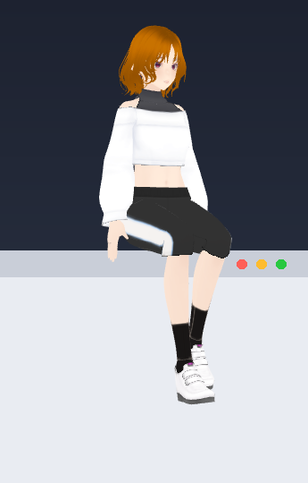
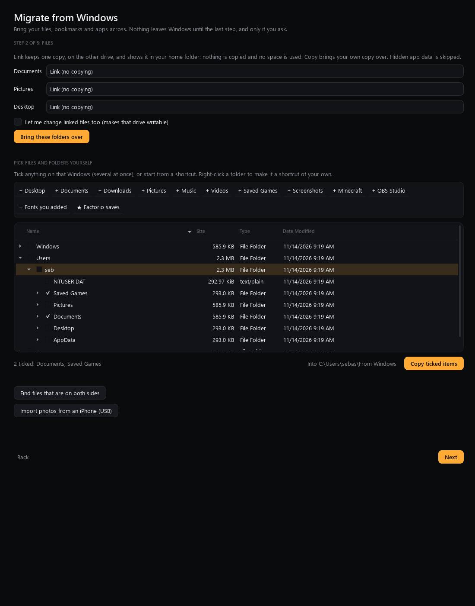
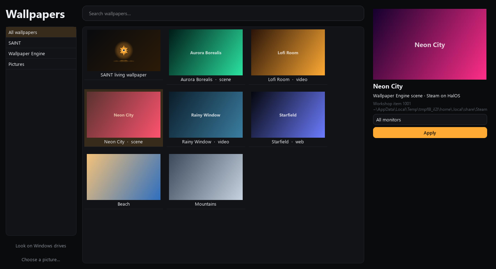
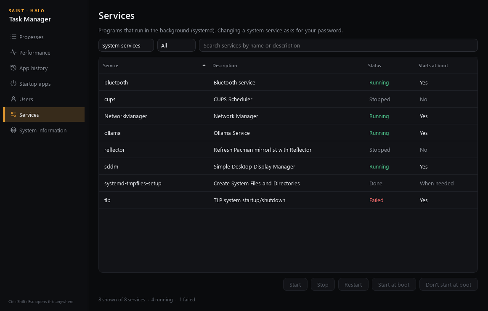
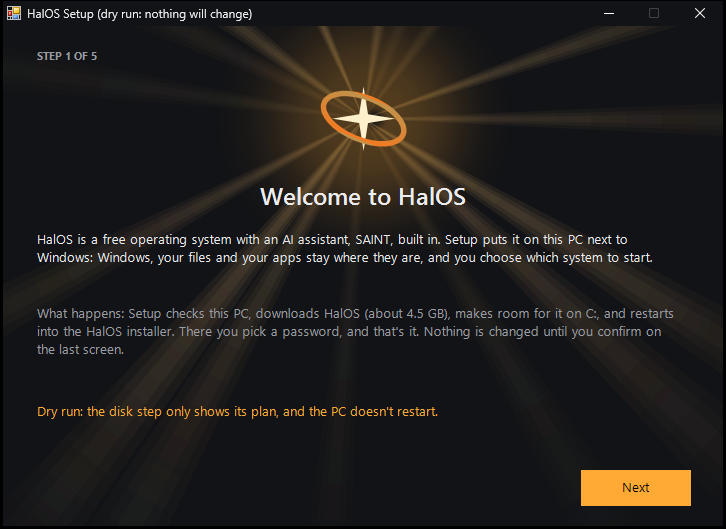

# HalOS 2.3.0-beta.1: what's new and how to test it

Install: [INSTALL_GUIDE.md](INSTALL_GUIDE.md) (HalOS-Setup.exe → *Install alongside Windows* or *Update HalOS*).
Already on HalOS 2.2? Settings → Updates → SAINT → *Check now*. Packaging changes (sound defaults, Obsidian, the
visualizer widget, the Wallpapers app, KWin scripts) need *Update HalOS* from HalOS-Setup.exe or the new ISO.

Each section ends with **Test:** steps. Tick them off and report anything odd with Settings → About → *Copy log*.
After the first login on 2.3 a small *What's new* card appears bottom right; click it for the full list.

## SAINT feels alive
- **"Hey SAINT"**: she rises from below the screen onto the taskbar (or the top of the window you're in) and listens.
- **Pop-in** every time she appears; **walks** across the screen on her own; idle animations vary.
- **Sits on windows**: drop her on a window and she sits on its top edge and follows it when it moves.
- **Dances** on a playing music window (Spotify), on the beat when the tempo is known, else 112 BPM.
- **Looks at you**: her head and eyes follow the cursor; while you type she looks at what you're typing.
- **Rests out of the way**: she picks the spot that hides the least of your window, stays on one of your monitors,
  and learns where you like her (local `avatar_habits.json`).
- **Animations hold**: an animation you ask for plays to the end (60 s) instead of snapping back to standing.
- **Head and shoulders** is no longer cut off; right-click → *Head and shoulders / Full body*.
- **Answers without the wake word** for about 20 s after she appears or answers, never during games,
  fullscreen apps or calls (Discord, browser calls).

**Test:** say "Hey SAINT" → she rises and listens. Drag her onto a window → she sits; move the window. Play Spotify
and drop her on it. Ask her to play an animation from the right-click menu → it doesn't snap back. Switch Head and
shoulders / Full body. Open the Store and type in its search while she appears → the text goes to the Store.
After she answers, say something without "Hey SAINT" → she replies; start a game → she doesn't listen.

## Sound: your monitor's speakers, and a mixer
- NVIDIA HDMI/DisplayPort sound is never switched off or put to sleep, so a monitor with speakers appears
  (by name when the monitor reports it).
- **Settings → Sound**: every output with *Use* / *Turn on and use*, volume, mute and *Test*; each app's output,
  volume and mute; *Play on the checked outputs* (several at once).
- **Bluetooth**: stays on high-quality A2DP (SBC-XQ / AAC / LDAC when available) instead of switching to the choppy
  headset profile because the mic is on; larger buffer for Bluetooth outputs.
- **Fix the sound** now really repairs: turns a switched-off card on, restarts PipeWire if needed, switches to a
  plugged-in output, moves playing apps, unmutes, and says what it did.

**Test:** with the monitor connected over HDMI/DP from the NVIDIA card, open Settings → Sound → *Turn on and use* on
the monitor → *Test*. If it's silent, try the other HDMI outputs listed. Route one app to another output. Tick two
outputs → *Play on the checked outputs*. Connect Bluetooth headphones and play music for a few minutes with SAINT's
mic on → no choppiness. Press *Fix the sound* → it reports what it did.

## A smarter SAINT that doesn't interrupt
- Chat uses a small, fast Claude model through Claude Code when it's signed in; offline, the local model gets a
  compact, accurate picture of HalOS, this PC and what SAINT can do.
- Closing and reopening SAINT starts a fresh conversation; passing problems ("my sound isn't working") are not
  kept as memories.
- **Never steals focus**: SAINT's helper windows give the keyboard straight back, and work you didn't ask for never
  switches your virtual desktop.

**Test:** ask "what GPU do I have?" and "what can you do?". Talk about a problem, close SAINT, reopen it, say "hi" →
it doesn't bring the old problem up. Let SAINT do something on desktop 2 while you type on desktop 1.

## The Halo is its own app
The glow around the screen runs as its own process (`halos-halo`), so the SAINT taskbar icon always opens SAINT.

**Test:** with the Halo on, close SAINT's window, click the SAINT icon on the taskbar → SAINT opens.

## Evolve, Claude Code and SAINT Vault
- Evolve sends the prompt correctly (the "Input must be provided…" error is gone) and hides the harmless SEP-2352
  MCP warning.
- Not signed in? Evolve shows *Sign in to Claude Code* (or *Install Claude Code*) and checks again afterwards.
- **Obsidian** comes with HalOS (Flathub; installs in the background, or on first click).
- **SAINT Vault** (`~/Documents/SAINT Vault`): SAINT's notes and memory as Markdown. Every Claude Code run SAINT
  starts can read it, and the Obsidian skills (Markdown, Bases, Canvas) are installed for Claude on first run.

**Test:** SAINT → Evolve: press *Sign in to Claude Code*, sign in, then describe a small change → it runs without the
error. Open Obsidian → open folder as vault → Documents/SAINT Vault. Tell SAINT a fact about you → a note appears in
*Memory/*.

## Window animations, What's New, wallpapers
- The SAINT star opening plays to the end and its close shrinks on both axes.
- Animations: changes preview first and apply only on **Save** (*Revert* undoes). **Profiles**: pick animation and
  speed for open, close, minimise and desktop switch; built-ins SAINT, Supernova, Snappy, Calm, Off.
- What's New: honest cards that open the real feature, expandable details, and a popup after each update.
- The living wallpaper's black screen is fixed (its plugin wasn't packaged). The visualizer is also a **widget**
  (SAINT Visualizer) you can put over any wallpaper.
- **HalOS Wallpapers** app: SAINT's living wallpaper, every Wallpaper Engine wallpaper (HalOS Steam, the Windows
  drive's Steam, migrated ones) and your pictures.

**Test:** Settings → Animations: move the speed slider → only the preview changes until *Save*; make a profile.
Close a window with the SAINT star. Open HalOS Wallpapers → apply a Wallpaper Engine wallpaper; *Look on Windows
drives*. Settings → Wallpaper → *Add the visualizer widget* and talk to SAINT.

## Migrate, Files, screenshots, Task Manager, Setup
- **Migrate from Windows**: browse the whole Windows drive and tick what to copy; your own *Quick add* shortcuts
  (right-click a folder); every Windows install listed, the most recent preselected; failures are listed with
  reasons and *Retry* instead of stopping; Wallpaper Engine wallpapers come along. An unreadable Windows wallpaper
  falls back to Windows' cached copies.
- **Screenshots**: Print drags an area (Shift+Print all screens, Meta+Print the active window); SAINT's screenshots
  go through Spectacle on Wayland.
- **Files**: *Downloads & installs* (Open, Show in folder, Cancel for Store/Flathub installs) and *Trash* in the
  sidebar.
- **Task Manager**: every tab in the Processes style; numbers sort by value; search, summaries, plain words.
- **HalOS-Setup.exe**: dark mode on every page, with animated sunrays on the welcome page.

**Test:** Migrate → tick a few folders → *Copy ticked items*; add a Quick add shortcut; check the failure list.
Press Print and drag an area. Files → Downloads & installs while installing something from the Store → Cancel.
Task Manager → sort Services and App history. Run HalOS-Setup.exe on Windows → dark pages, moving rays.

## Known limits
- Nothing in 2.3 has run on real hardware yet; the ISO boots and installs in VMs.
- Sitting on windows needs Plasma Wayland (the KWin script says which window she's over).
- Which of the NVIDIA card's HDMI outputs is the monitor is guessed when the monitor isn't detected: use *Test*.
- Pause for downloads isn't offered (pacman, browsers and Steam can't be paused safely from outside).
- Moving HalOS onto the big partition while keeping Windows files is planned ([HALOS_ROADMAP.md](../HALOS_ROADMAP.md)).

