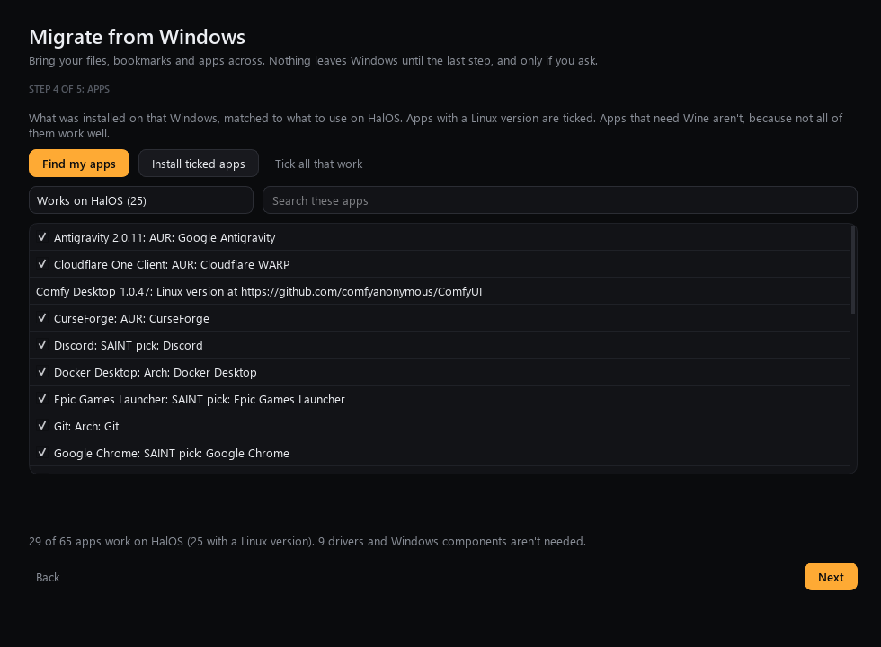
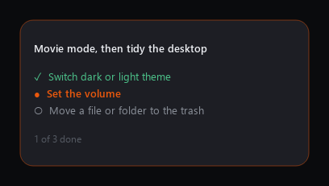
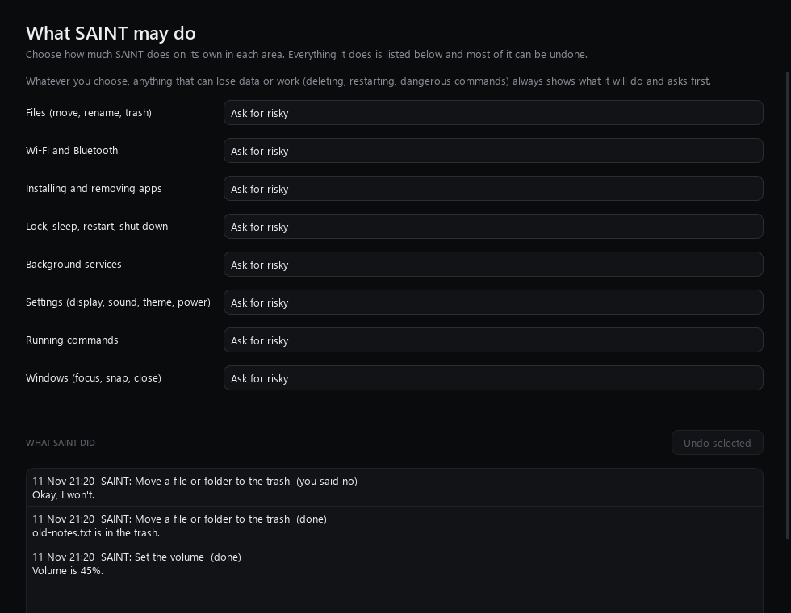

# HalOS v2, wave 1: bug list, AI control of the OS, installer fixes

Started 2026-11-10 on branch `halo/roadmap-2026-11`. This page says what was built, how it was checked, and what
has not been checked yet. The plan is in [FABLE_MASTER_PROMPT.md](../FABLE_MASTER_PROMPT.md); one line per
landed item is in [PROGRESS.md](../PROGRESS.md).

## How the work was run

The first attempt ran five workstreams as parallel agents, each in its own git worktree. That used up the
usage limit twice with very little committed. From then on the work was done one item at a time in a single
session: finish the item, run its tests, commit, merge, push, then start the next.

Everything below was tested with `pytest` on the Windows development PC (full suite after the five merges:
**2,160 passed, 5 skipped**). **Nothing in this wave has been run on a HalOS system yet**: no ISO has been built
from this branch and no VM check has been done. Those checks are listed at the end.

## What landed

### Bug list from the notes

| Reported | Cause found | Fix |
|---|---|---|
| Close animation is just the logo exploding; it also plays on new tab and fullscreen | The effect didn't move the window itself, and an app swapping one window for another counted as a close | The window now pulls inward and then bursts; only real opens and closes animate |
| Animations tab: scale, profiles, Preview and "Try on real windows" don't work | The sliders, profiles and both buttons didn't reach the KWin effect | Every control now writes the config and reloads the effect |
| The SAINT app is the halo; the taskbar icon minimises it; it's on the wrong screen | The halo followed the main window's minimised state, and on Wayland Qt's "primary screen" is only the first output listed | The halo is its own overlay, the taskbar icon opens SAINT, and the real primary monitor is asked from Plasma |
| Screenshots: stray effects, the editor flashes after copy or save, files not in Screenshots | SAINT's window animation and burst ran on the screenshot tool's own windows; Spectacle's defaults open its editor | Screenshot tools are left alone; Spectacle saves to Pictures/Screenshots, copies at once and quits after copy or save |
| "pacman is busy. Try again when it's finished" | A busy package database was treated as an error | One queue: installs wait for pacman and for each other, and a stale lock is cleared safely |
| Little feedback when searching the Store | The search showed nothing until all sources answered | Spinner, per-source progress and placeholder tiles appear at once; work buttons show busy, done or failed |
| Migration says most apps can't be migrated, including Antigravity | Matching was by name against the Store only. Windows lists Antigravity as "Antigravity IDE (User)" | A curated table of 302 Windows apps is checked first; drivers and runtimes are "not needed", not failures |
| Hard to see which apps work | One flat list | Filters with counts, search, and "Tick all that work" |
| Step 5 shows little feedback | A job's progress bar started at zero with no text | Every wizard job says "Working…" with a moving bar the moment its button is pressed |
| Recovery can't reboot without installing dependencies | Restart went through tools that might be missing, and background downloads could hold it up | "Restart now" uses only what the image ships and falls back three ways; no password for the person at the PC |
| Install fails with an unexplained error | Calamares's failure wasn't read | The failed step's log is turned into a plain reason, with Retry and Copy log |

The Apps step of the migration wizard, filled from the development PC's real list of installed apps (read
only, matched offline against the table):

On that PC, 173 installed entries collapse to 74 rows: 25 with a Linux version, 4 that run with Wine or in the
browser, 9 with a suggested alternative, 9 groups of drivers and Windows components that aren't needed, and 27
that the table doesn't know, which go to the Store search.

### AI control of the OS

`core/actions` is one registry of typed OS actions that SAINT and the HalOS apps will all call: 38 actions in
8 categories (settings, network, files, packages, services, power, windows, shell). See
[ACTIONS.md](../ACTIONS.md).

- **Trust levels** per category: ask every time, ask for risky (default), or trusted. Destructive actions
  always show a preview and ask, whatever the level.
- **Log and undo**: every action is logged with secrets removed; most can be undone.
- **SAINT** runs actions from plain phrases with no model call ("dark mode", "turn bluetooth off", "run the
  command df -h", "undo that"). A shell command is shown exactly as it will run and waits for a yes.
- **Plans**: a multi-step command runs as a plan, and a panel at the top right shows each step live. It never
  takes focus or clicks.

(The panel above is the real widget rendered on the development PC with sample steps; nothing was executed.)

Settings has a page, **What SAINT may do**, to set the trust level for each area and to see and undo what
SAINT did:

(Rendered on the development PC with a temporary log filled by sample actions that change nothing.)

A lesson from testing: an early version of the action tests left the power actions unmocked, so running them on
the Windows PC could have locked or restarted it. The run was blocked before anything happened, and the test
fixture now patches every action module and fails if a real power call is reached.

## Not done or not verified

- No ISO build and no VM run from this branch yet. Needs checking on Plasma: the close animation, the halo on
  two monitors, Spectacle's settings, every Linux command line the actions run, Recovery's restart, a forced
  install failure.
- Wave 1 items still open: `HalOS-Setup.exe`, the shorter Calamares flow, boot-time benchmark, ISO size report.
- The migration undo journal exists with tests but the wizard's steps don't all go through it yet.
- AIDE 2.0 is on GitHub (`uberdiz/AIDE`, branch `aide-2.0`); its Linux build hasn't been started.
