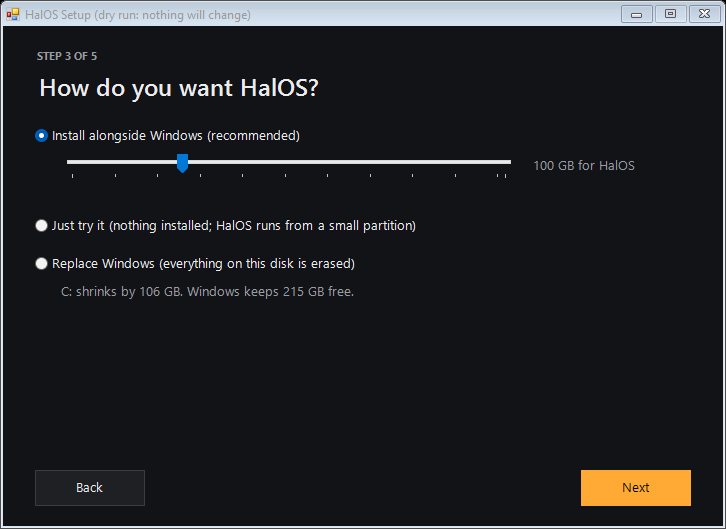
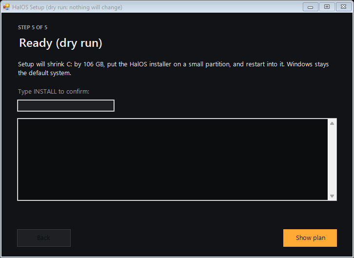

# HalOS v2, wave 1 (continued): browser-easy install and fast boot

Continues [wave 1](wave-1.md). Same rule as before: tested on the Windows development PC; nothing here has run
on a HalOS system yet, and no ISO is built until every wave is coded.

## HalOS-Setup.exe

A Windows program that installs HalOS the way you'd install a browser: download one small file, click through
five screens, done. It is **50 KB**, built with the C# compiler that ships with every Windows 10 and 11, so
building it needs nothing installed (`packaging/windows-host/setup/build_setup.ps1`).

| Step | What it does |
|---|---|
| 1. Welcome | Says what will happen and that nothing changes until the last screen |
| 2. Checks | UEFI, Secure Boot, BitLocker, free space, memory, internet, each in one plain sentence. Reads only; no administrator rights |
| 3. Choice | Alongside Windows (with a size slider), Just try it, or Replace Windows |
| 4. Download | The ISO from the GitHub release, resumable, checked against `SHA256SUMS`. Or pick an ISO you already have |
| 5. Ready | Type `INSTALL` (or `REPLACE`) to confirm; one administrator prompt; it restarts into the installer |

The screens above are the real program drawn in its `--screenshot` mode, which runs nothing.

All disk work (shrinking C:, the HALOLIVE partition, the boot entry) is still done by the existing, tested
`prepare_disk_boot.ps1`, which Setup carries inside itself and runs with the user's choices. A test checks that
the EXE itself contains no disk command. BitLocker, when it is on, is paused for three restarts with the user's
OK, the only system change Setup makes itself. `--dry-run` passes `-WhatIf` to the disk step and never
restarts.

## The installer after the restart

The simple path (install into the space Setup made) is now three installer pages: Welcome (language), your
account, and the summary. The time zone comes from the network's location (else the live system's clock, else
UTC), and the keyboard and language come from the live desktop. The full installer, with every page, stays
for advanced use.

## Fast boot

- The installed system's start-up image (initramfs) holds only this PC's drivers and is compressed with zstd,
  which unpacks quickly.
- Booting is quiet behind the HalOS splash.
- With HalOS as the only system there is no boot-menu wait at all (hold Shift or press Esc to see it). With
  Windows on the PC, the menu waits 5 seconds.
- First-boot downloads (Flatpak apps, the AI model) never hold up start-up or restart.
- `packaging/arch/tools/boot-benchmark.sh` records where boot time went (firmware, loader, kernel, initramfs,
  userspace), the slowest services and idle memory, as JSON. It reads only. It has been tested against
  recorded `systemd-analyze` output, not yet on a real boot.

## Not verified yet

- A real install from Setup on a PC or VM (download from a published release, shrink, restart, install).
- Boot time and idle memory numbers: they need the benchmark run on an installed system.
- The release itself: `Halo-x86_64.iso` and `SHA256SUMS` must be attached to a GitHub release for Setup's
  download to work; until then, "Use a HalOS ISO I already have" works.
