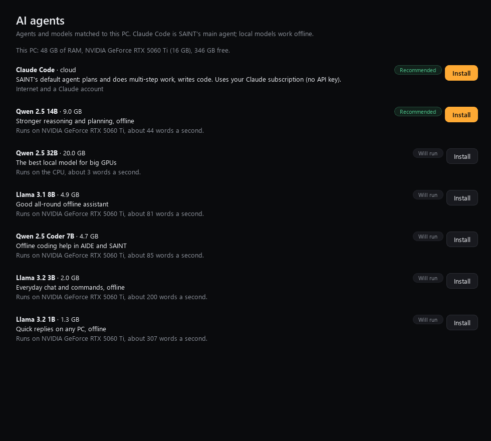
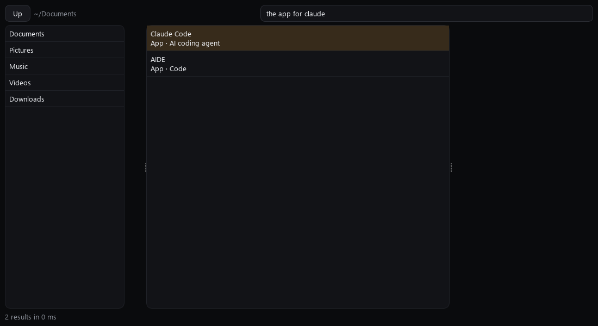
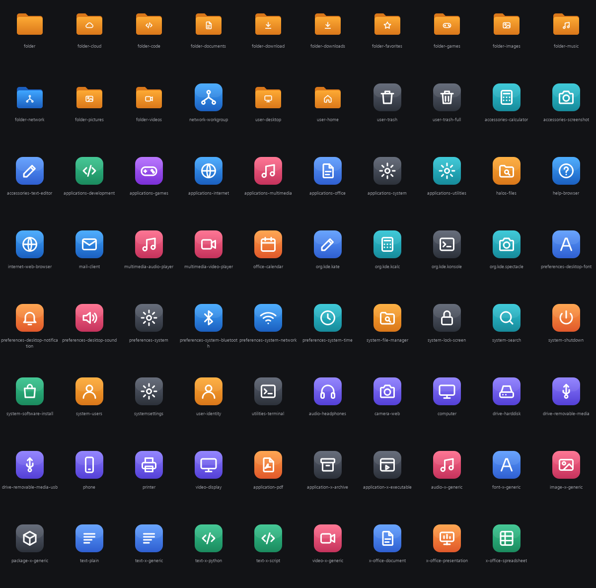

# HalOS v2, waves 2 and 3: the AI OS

Continues [wave 1](wave-1.md) and [wave 1, continued](wave-1b.md). Built 2026-11-11 to 2026-11-12, one item at a
time: coded, tested, committed and pushed before the next began. One line per item is in
[PROGRESS.md](../PROGRESS.md).

**How far it is verified.** Everything here passes its tests on the Windows development PC: **2,332 HalOS tests
and 94 AIDE tests pass**. On HalOS itself none of it has run yet. By decision, no ISO is built until every wave is
coded, so every Linux-only behaviour below still needs its VM check (listed at the end).

## SAINT does the work: agent mode on Claude Code

SAINT hands bigger jobs to **Claude Code**, using your own Claude subscription rather than an API key ("ask claude
to fix the failing tests", or the new **Agent** page). Each task runs in the background and never takes focus.
Several can run at once.

- **Live steps.** Claude Code's own todo list (or each tool call) becomes the plan panel's step list, live.
- **Follow-ups** resume the same Claude session, so the history isn't sent again (fewer tokens).
- **Trust levels.** Set the Claude Code agent's trust in *What SAINT may do*:
  - **Ask every time**: Claude only plans, and you approve the plan before anything changes.
  - **Ask for risky**: it may read and edit files in the task's folder; commands and the web are refused.
  - **Trusted**: Claude Code's own safety checks decide. It never runs with permissions bypassed.
- **Short summaries.** Each run is saved as a short summary, never the transcript, so what SAINT carries forward
  stays small.

**AIDE 2.0**, your AI code editor, now uses the same backend. It has a `claude-code` provider (the default,
resuming sessions, no API key), and its build scripts make Linux builds. It ships in HalOS as the **Code** app,
built from `uberdiz/AIDE` branch `aide-2.0`.

## Everything manageable by the AI, safely

All of SAINT's OS control goes through one action registry (45 actions in 9 areas). Each area has its own trust
level, every action is logged, and most can be undone.

- **Quick settings** is built from the registry. Its search box takes plain requests: "dark mode" becomes one
  button.
- **What SAINT may do** shows the trust levels and the undo list.
- SAINT runs plain phrases with no model call: "turn bluetooth off", "make the text bigger", "run the command
  df -h" (it shows the exact command and asks first), "what's downloading?", "tile my windows", "undo that".

**Working without stealing your focus.** SAINT has a hidden background desktop: a virtual display where it can
open apps, type, click and look while your keyboard, mouse and windows stay yours. "Show me" opens a live view
of it. Visible windows for parallel work are split across the screen without being activated.

## Agents matched to your PC

**AI agents** rates each model for this PC as recommended, will run, or too heavy, with the reason and an
estimated speed, and installs it in one click. Claude Code is first. Models already downloaded on a Windows disk
are copied over instead of downloaded again. (The screenshot is rated for the development PC's real hardware.
Taking it caught a rounding bug that called a 48 GB PC 47.9 GB.)

## HalOS Files

**Files** is now HalOS's file manager and the default for folders. Its search reads plain words without a model:
"the app for claude" finds Claude Code and AIDE, "photos from last week", "big videos", "tax pdf". The index is
incremental. On the development PC it indexed 20,000 files in 1.5 s, re-checked them in 93 ms when nothing had
changed, and answered searches in 2 to 8 ms. New folder, rename and trash go through the actions, so Ctrl+Z
undoes them. (The screenshots use a sample folder, not your files.)

## Bring everything (continued)

- **SAINT and Claude history.** SAINT's history (merged without duplicates) and memory, and Claude Code's
  projects, history, settings and skills come over. Sign-in tokens never do. Everything goes through the undo
  journal.
- **Exporters.** For Windows and macOS: run one before "Replace Windows", or when the old disk can't be read.
  The wizard finds the export on any drive and reads it like a Windows disk. Wi-Fi networks import too, with
  passwords only if you exported them on purpose.
- **Duplicates.** Files on both sides are found by content. HalOS proposes to keep one or keep both, and merges
  only after your yes. Nothing is deleted.
- **iPhone photos** import over USB (new ones only). Your phone can also browse the PC's Pictures over SAINT
  Link (your own devices only).
- **Passwords:** clear steps to export them from Chrome, Edge, Brave, Apple Passwords or Firefox and import them
  into the browser. SAINT never reads them.

## Look and feel

**Living wallpaper** (the new default):

- a colour or a gradient at any angle
- the SAINT logo anywhere on each monitor, at any size, with a glow and visualizer bars
- it moves with SAINT's voice, the music playing, the microphone, or a slow breath, or stays still
- a frame-rate cap, and nothing redraws when still

Sound is read as levels only, live, and only while a wallpaper listens.

**HalOS icons:** 79 icons in one style, in dark and light versions, for places, folders, file types, devices
and system apps. App makers' logos and the HalOS and SAINT logos are left as they are.

## Camera presence (off until you turn it on)

- **When you leave:** the screen locks, then turns off (or the PC sleeps, if you choose that).
- **When you come back:** the screen wakes to the lock screen. It never unlocks for you.
- **When you look away:** what's playing pauses, and plays again when you look back.

Frames are checked for a face on the PC and thrown away. The settings page also says plainly that a sleeping PC
can't see you come back.

## Mistakes caught along the way

- A search for "bluetooth" also found Night Light, because its keyword "blue" matched the start of the word.
  Fixed: a keyword now matches a longer word only when it's most of it.
- In two commits, the full test run went alongside the commit instead of before it, so a broken label and a
  broken string got pushed. Both were fixed in the next commit. Tests now always run before a commit.

## What still needs checking on HalOS (one build and VM pass, after all waves)

- **Install:** HalOS-Setup.exe end to end, the 3-page installer, Recovery's restart, a forced install failure.
- **Boot:** boot time and idle memory with the benchmark script.
- **Desktop:**
  - the close animation, and the halo on two monitors
  - Spectacle's settings
  - the wallpaper's glow and sound feeds, and the icon theme in the panel and in Files
- **SAINT's control of the OS:**
  - every Linux command line the actions run
  - the background desktop (Xvfb, xdotool, screenshots)
  - window tiling under KWin
- **Apps:** AIDE's Linux build during the ISO build, and Claude Code sign-in on HalOS.
- **Hardware:** camera presence with a real webcam, and iPhone import with a real phone.
